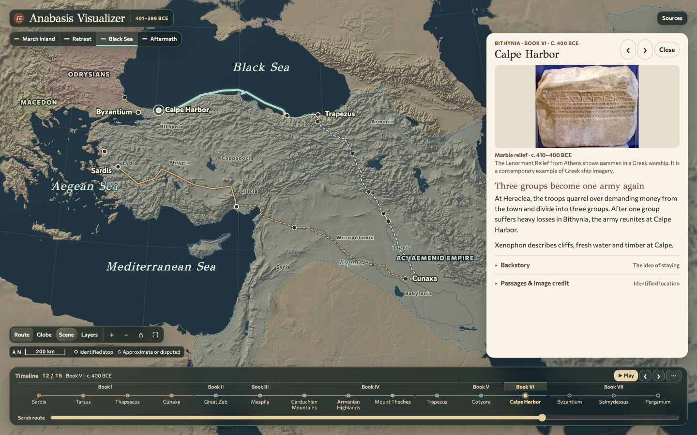
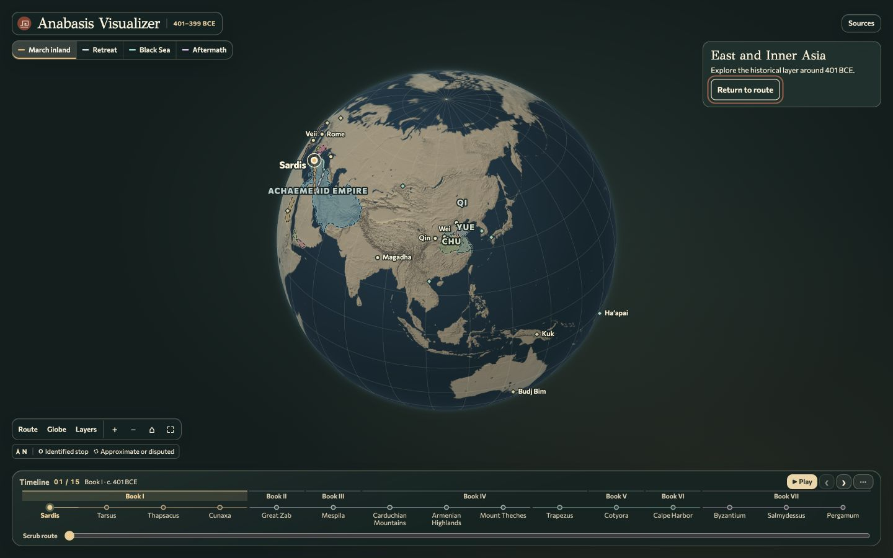
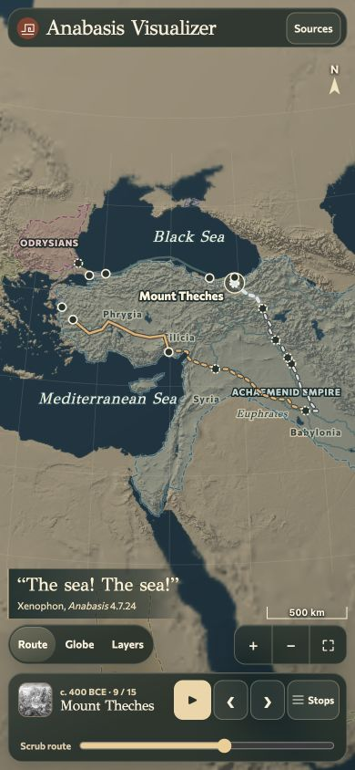

# Anabasis Visualizer

**A playable historical atlas of Xenophon’s *Anabasis*, 401–399 BCE.** Follow Cyrus the Younger’s march from Sardis toward Babylon and the Greek soldiers’ retreat to the Black Sea. Fifteen illustrated stops trace all seven books on a rotatable globe.

**[Open the atlas](https://anaba5is.github.io/anabasis-visualizer/)** · [Start at Sardis](https://anaba5is.github.io/anabasis-visualizer/#stop=sardis) · [Jump to Mount Theches](https://anaba5is.github.io/anabasis-visualizer/#stop=mount-theches)

[](https://anaba5is.github.io/anabasis-visualizer/#stop=calpe)

*At Calpe Harbor, the reader opens beside the globe. The Lenormant Relief offers a contemporary example of a Greek warship. Photograph by Marsyas, shown at reduced size. [Image source](https://commons.wikimedia.org/wiki/File:ACMA_Relief_Lenormant.jpg) · [CC BY-SA 2.5](https://creativecommons.org/licenses/by-sa/2.5/)*

## Inside the atlas

- **Follow the expedition.** Play or scrub the timeline, step through the stops, or jump directly to a map pin. The route distinguishes the inland march, retreat, Black Sea journey, and aftermath.
- **Read the evidence.** Each stop pairs a short account with artwork, optional context, and links to Xenophon and the image source. Most scenes feature ancient coins, reliefs, or objects.
- **Explore the wider world around 401 BCE.** Rotate the globe, switch historical layers, or jump from the catalogue to a polity, site, or community. Places and route stops have shareable links.

| World atlas | Phone view |
| :--- | :--- |
| <a href="https://anaba5is.github.io/anabasis-visualizer/#world=east-asia"></a> | <a href="https://anaba5is.github.io/anabasis-visualizer/#stop=mount-theches"></a> |
| Approximate historical geography across East and Inner Asia and the Pacific. | The retreat reaches Mount Theches. Tap the scene to open the reader. |

## How it’s built

Native JavaScript modules render an orthographic WebGL globe with a Canvas 2D fallback and SVG map overlays. The globe, timeline, and reader share the selected stop. Terrain, artwork, and fonts are served with the site. [Code guide and browser checks](docs/development.md)

The coastline and relief use modern Natural Earth data. Dashed route legs mark uncertainty, and political outlines are approximate reconstructions around 401 BCE. [Historical sources](historical-sources.md) · [Research notes](research.md) · [Design references](design-references.md)

## Run locally

Serve the repository root and open [localhost:8041](http://127.0.0.1:8041/). The atlas needs no build step or API key.

```sh
python3 -m http.server 8041 --bind 127.0.0.1
```

Run the automated checks separately with `node --test tests/*.test.mjs`.
